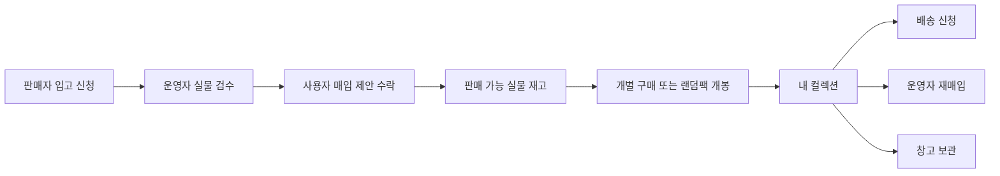

# 서비스 기획서

| 항목 | 내용 |
| --- | --- |
| 프로젝트 | Pokemon-Trader-Gos |
| 문서 ID | SPD-Pokemon-Trader-Gos-v0.1 |
| 작성일 | 2026-11-24 |
| 상태 | 초안 · G0 검토 전 |
| 대상 플랫폼 | Android 앱 |
| 승인자 | 미결 |

## 변경 이력

| 버전 | 날짜 | 변경 내용 |
| --- | --- | --- |
| v0.1 | 2026-11-24 | PRD v0.2와 화면 설계를 바탕으로 Phase 0 초안 작성 |

## 1. 서비스 개요

Pokemon-Trader-Gos은 운영자가 검수하고 보관하는 실물 포켓몬 카드를 개별 구매하거나 랜덤팩으로 얻은 뒤, 앱에서 보관·배송·재매입을 관리하는 서비스다. 운영자가 실물을 보관하는 동안에는 사용자가 다시 팔 때 카드를 따로 보내지 않아도 된다.

| 대상 | 사용자 문제 가설 | 첫 검증 방법 |
| --- | --- | --- |
| 카드를 정리하려는 판매자 | 여러 장을 하나씩 판매하고 배송하는 과정이 번거롭다. | 입고 조건을 스스로 확인하고 검수 결과와 매입 제안을 찾는지 관찰한다. |
| 포켓몬 카드 수집가 | 구입 전에 실제 상태를 알고 싶고, 구입 후에는 보관과 배송 시점을 선택하고 싶다. | 사진·상태·가격을 확인한 뒤 컬렉션에서 보관 상태와 다음 행동을 찾는지 관찰한다. |
| 운영자 | 같은 종류의 카드도 실물마다 상태와 배정·보관·출고 이력을 확인해야 한다. | 재고 번호로 검수부터 판매·출고까지 추적 가능한지 확인한다. |

문제와 수요는 사용자 설명 및 PRD에서 도출한 가설이다. 인터뷰나 시범 사용 결과는 미결이다. 이용자 간 직접 거래와 직접 발송이 필요한 경우는 이번 서비스 흐름에 포함하지 않는다.

## 2. 핵심 메커니즘

- **판매자** · 카드 정보와 앞뒷면 사진을 등록한다. 적용 중인 입고 조건을 확인한 뒤 신청하고, 검수 사유와 매입가를 확인해 수락한다.
- **수집가** · 원하는 실물 매물을 고르거나 팩 구성을 확인해 개봉한다. 얻은 카드는 컬렉션에 들어가고, 보관 중 배송을 신청하거나 재매입 제안을 받을 수 있다.
- **운영자** · 검수 결과와 제안가를 기록하고, 매입한 실물을 판매 또는 팩 재고로 배정한다. 배송 요청의 출고 상태와 운송장을 관리한다.

## 3. 콘텐츠·기능 전략

마켓은 이름·세트·카드 번호 검색과 희귀도·검수 상태 필터를 제공한다. 카드 상세에서는 실물 앞뒷면과 하자 사진, 희귀도, 검수 결과, 재고 번호, 가격을 확인할 수 있다. 랜덤팩은 여러 레어도를 포함한 혼합형과 한 레어도만 포함한 단일 레어도형을 제공한다. 팩별 포함 코드·장수·테스트 코인 가격을 안내하고, 지정 재고에서 한 장을 무작위 배정한다.

카드에 인쇄된 레어도 코드는 검색, 입고 확인, 가격 기준표와 팩 구성에 직접 사용한다. 실물 상태는 검수에서 따로 판정한다. [레어도 확인 기준](비즈니스정책서.md#인쇄-레어도-분류)

Android 메뉴는 마켓·랜덤팩·입고·컬렉션·내 정보로 구성한다. 크림색 배경과 사진 중심 그리드를 사용하고, 희귀도·검수 결과·배송 상태는 각 항목 이름을 표시한다. 화면 구성과 디자인 토큰은 [DESIGN.md](../../../DESIGN.md)를 따른다.

## 4. 수익화 전략

첫 버전은 테스트 잔액으로 차감·적립과 거래 상태를 검증한다. 실제 수익 모델과 수수료는 미결이다. 실제 결제, 현금 결제형 랜덤팩, 계좌 출금은 출시 요건과 운영 범위를 확인한 뒤 검토한다.

## 5. MVP 범위

| ID | 우선순위 | 포함 기능 | 확인할 결과 | 정책 |
| --- | --- | --- | --- | --- |
| MVP-01 | P1 | 입고 신청 및 내역 | 적용 중인 입고 요건 확인, 미충족 시 신청 제한, 신청 번호와 상태 조회 | BP-IN-001 |
| MVP-02 | P1 | 검수와 최초 매입 | 판정·사유·제안가 확인, 검수 후 조건 미달 시 보류, 수락 시 1회 적립 | BP-IN-002, BP-PRICE-001, BP-BAL-001 |
| MVP-03 | P1 | 개별 매물 탐색 및 구매 | 실물 상태·가격 확인 후 구매한 재고를 컬렉션에서 확인 | BP-STOCK-001, BP-BAL-001 |
| MVP-04 | P1 | 테스트 랜덤팩 | 구성 확인 후 팩에 배정된 실물 1장 획득, 배정 실패 시 차감 없음 | BP-PACK-001, BP-STOCK-001, BP-BAL-001 |
| MVP-05 | P1 | 컬렉션과 배송 요청 | 보관·배송 상태와 출고 후 등록된 운송장을 확인 | BP-AUTH-001, BP-FUL-001 |
| MVP-06 | P1 | 재매입과 잔액 내역 | 보관 중인 실물을 재매입하고 적립을 한 번만 기록 | BP-PRICE-001, BP-FUL-001, BP-BAL-001 |
| MVP-07 | P1 | 운영 관리 | 입고·검수·실물 재고·배송 요청을 권한이 있는 운영자가 처리 | BP-AUTH-001, BP-IN-002, BP-STOCK-001, BP-FUL-001 |

| ID | 제외 범위 | 이유와 MVP에서의 처리 |
| --- | --- | --- |
| EX-001 | 실제 결제·유료 랜덤팩·계좌 출금 | 출시 검토와 자금 처리 범위가 미결이다. 테스트 잔액으로 거래·정산 흐름을 검증한다. |
| EX-002 | Android 외 플랫폼의 첫 버전 제공 | 첫 버전은 Android에서 검증한다. 이후 플랫폼은 시범 사용 결과를 바탕으로 검토한다. |

실물 배송을 어디까지 시범 운영에 포함할지와 계정 발급 방식은 7절에서 결정한다.

## 6. 가설 검증과 성공 기준

| 가설 | 관찰 지표 | 검증 결과의 활용 |
| --- | --- | --- |
| 판매자는 도움 없이 입고 조건과 검수 결과를 이해할 수 있다. | 입고 완료율, 조건 미충족 후 수정 여부, 검수 결과 조회 여부 | 신청에서 이탈이 많으면 부족한 조건을 알려주는 위치와 문구를 점검한다. |
| 수집가는 구매·개봉 후 실물 카드와 다음 행동을 찾을 수 있다. | 성공 건 중 컬렉션 조회 비율, 배송 및 재매입 요청별 완료율 | 컬렉션 이동과 다음 행동을 찾지 못하면 결과 화면 배치를 점검한다. |
| 운영자는 실물 한 장의 거래 이력을 추적할 수 있다. | 시범 건에서 재고 번호로 검수·배정·출고 상태를 확인한 결과 | 누락된 전환이나 조회 정보가 있으면 운영 흐름을 보완한다. |

제품 지표의 목표치와 측정 기간은 시범 사용 결과를 바탕으로 정한다. 기능 검증에서는 입고부터 구매까지, 팩 개봉부터 배송 또는 재매입까지 각각 완료해야 한다. 입고 요건 미충족, 팩 레어도 불일치, 검수 반려 카드 노출, 동시 배정·배송과 재매입 충돌·중복 정산 사례도 확인한다.

## 7. 다음 단계와 미결 결정

| ID | 확인할 내용 | 영향 | 담당자·기한 |
| --- | --- | --- | --- |
| DEC-001 | 동봉할 대상·동봉 레어도 코드와 장수, 동봉 카드 중복 인정 및 매입 여부, 프로모·무표기·해외판 및 추가 코드의 수용 범위 | MVP-01·02·04 | 미지정 · 미정 |
| DEC-002 | 가격표 금액, 예외 제안 기준, 하자 매입 카드 판매·팩 배정 범위 | MVP-02·03·04·06 | 미지정 · 미정 |
| DEC-003 | 보류·반려·제안 미수락 시 실물 처리와 택배비 적용 구간 | MVP-02·07 | 미지정 · 미정 |
| DEC-004 | 혼합형·단일 레어도형 팩별 테스트 코인 가격과 허용 코드·재고 수량, 일부 코드 소진 시 판매 조건 | MVP-04 | 미지정 · 미정 |
| DEC-005 | 실제 입고·출고 검증 범위, 구매자 출고 배송비와 묶음 배송 | MVP-01·05·07 | 미지정 · 미정 |
| DEC-006 | 테스트 계정 또는 실제 가입·인증 방식 | Android 사용자·운영자 접근 | 미지정 · 미정 |

G0에서 MVP 포함·제외 범위, 적용할 정책과 성공 기준을 검토한다. 미결 항목은 결정 내용과 근거를 기록하고, 승인 시 대상 버전·승인자·날짜를 [단계별 검토 체크리스트](../08-검토/단계별검토-체크리스트.md)에 남긴다.

## 8. 관련 문서

- [PRD.md](../../../PRD.md) · MVP 요구사항과 기능별 수용 기준
- [DESIGN.md](../../../DESIGN.md) · 화면 구성과 UI 가이드
- [비즈니스정책서](비즈니스정책서.md) · 거래 조건·판정과 예외 규칙
- [SRS 템플릿](../01-요구사항분석/요구사항명세서-SRS.md) 및 [RTM 템플릿](../01-요구사항분석/요구사항추적매트릭스-RTM.md) · G0 검토 후 MVP ID와 개별 정책 ID를 연결할 문서
