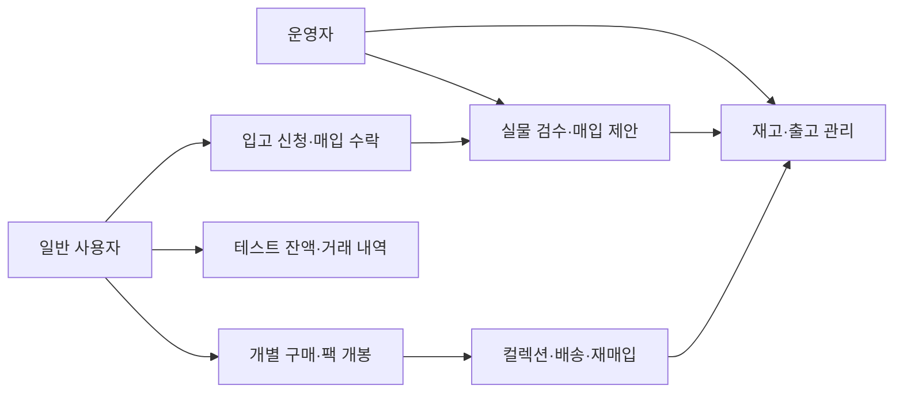

# 유스케이스 명세서

| 항목 | 내용 |
| --- | --- |
| 프로젝트 | Pokemon-Trader-Gos |
| 문서 ID | UC-Pokemon-Trader-Gos-v0.1 |
| 작성일 | 2026-11-24 |
| 상태 | Phase 1 초안 · G1 미승인 |
| 승인자·승인일 | 미결 |

## 변경 이력

| 버전 | 날짜 | 내용 |
| --- | --- | --- |
| v0.1 | 2026-11-24 | Phase 0 서비스기획서·비즈니스정책서 v0.1 기준 초안 작성 |

## 1. 시스템 경계와 흐름

## 2. 액터

| 액터 | 역할 |
| --- | --- |
| 일반 사용자 | 입고 신청자와 구매자 역할을 수행하며 본인의 컬렉션·거래·배송 정보를 조회한다. |
| 운영자 | 부여된 권한으로 실물 검수, 매입 제안, 재고 배정과 출고를 처리한다. |

실물 택배 흐름은 입고와 배송의 업무 전제다. 실제 물류 검증이나 별도 택배사 연동 방식은 후속 결정에서 확인한다.

## 3. 유스케이스 목록

| ID | 이름 | 액터 | 관련 요구사항 |
| --- | --- | --- | --- |
| UC-001 | 입고 신청·조회 | 일반 사용자 | FR-001 |
| UC-002 | 실물 검수와 매입 제안 | 운영자, 일반 사용자 | FR-002 · FR-003 · FR-010 |
| UC-003 | 최초 매입 수락 | 일반 사용자 | FR-003 · FR-009 |
| UC-004 | 매물 탐색과 개별 구매 | 일반 사용자 | FR-004 · FR-005 · FR-009 · NFR-002 · NFR-003 |
| UC-005 | 랜덤팩 개봉 | 일반 사용자 | FR-006 · FR-009 · NFR-002 |
| UC-006 | 컬렉션 조회와 배송 요청 | 일반 사용자, 운영자 | FR-007 · NFR-001 · NFR-002 · NFR-003 |
| UC-007 | 보관 카드 재매입 | 일반 사용자, 운영자 | FR-008 · FR-009 · NFR-002 |
| UC-008 | 테스트 잔액과 거래 내역 확인 | 일반 사용자 | FR-009 · NFR-001 |
| UC-009 | 재고 배정 및 출고 기록 | 운영자 | FR-010 · NFR-001 |

## 4. 상세 명세

### UC-001 입고 신청·조회

**액터** · 일반 사용자  
**진입 조건** · 사용자가 입고 화면에서 신청을 시작한다.

1. 카드별 이름·세트·번호·인쇄 레어도와 앞뒷면 사진을 등록한다.
2. 앱이 등록한 레어도 코드별 카드 수로 동봉 조건을 계산해 요구 코드와 필요·제출 장수를 표시한다.
3. 조건 충족 후 신청을 확인하면 신청 번호를 발급하고 택배 안내를 표시한다.
4. 신청 상세에서 운송장과 진행 상태를 확인한다.

**예외** · 미등록 또는 확인 불가 레어도는 자동 집계에서 제외하고 운영자 확인이 필요한 항목으로 표시한다. 동봉 수량이 부족하면 부족한 장수를 표시한다. 사진 등록에 실패하면 해당 카드에서 다시 시도할 수 있다.  
**종료 조건** · 조건을 충족한 신청만 확정되고 신청 상세에서 조회할 수 있다.

### UC-002 실물 검수와 매입 제안

**액터** · 운영자, 일반 사용자  
**진입 조건** · 권한 있는 운영자가 도착한 실물과 해당 입고 신청을 확인할 수 있다.

1. 운영자가 카드별 정품 여부와 상태를 보고 통과·하자·반려 및 사유를 기록한다.
2. 검수 결과에 따라 레어도 코드와 동봉 조건 충족 여부를 다시 확인한다.
3. 매입 가능 건에는 기준표 금액을 적용한다. 하자 등 예외에는 낮은 매입가를 제안하거나 반려할 수 있다.
4. 사용자가 결과와 사유, 해당하는 매입 제안 및 택배비 부담 안내를 본다.

**예외** · 검수 후 동봉 조건이 미달하면 묶음을 보류하고 사유를 표시한다. 반려 카드는 개별 판매나 팩에 배정할 수 없다.  
**종료 조건** · 검수 결과와 제안 상태를 조회할 수 있다. 실제 반환과 비용 적용은 DEC-003을 따른다.

### UC-003 최초 매입 수락

**액터** · 일반 사용자  
**진입 조건** · 검수가 끝나 수락 가능한 매입 제안이 있다.

1. 사용자가 검수 결과와 제안 금액을 확인한다.
2. 수락하면 최초 매입을 확정한다.
3. 사용자 테스트 잔액에 입고 매입으로 적립하고 매입한 실물을 운영자 재고에 등록한다.

**예외** · 수락 전에는 적립되지 않는다. 수락을 다시 전송해도 적립과 재고 등록이 중복되지 않는다. 제안 미수락 시 실물 처리는 DEC-003에서 결정한다.  
**종료 조건** · 수락된 거래와 적립 내역을 조회할 수 있다.

### UC-004 매물 탐색과 개별 구매

**액터** · 일반 사용자  
**진입 조건** · 사용자가 마켓을 열 수 있다.

1. 이름·세트·카드 번호로 검색하거나 희귀도·검수 상태로 필터링한다.
2. 선택한 매물의 실물 사진, 상태, 재고 번호와 판매가를 확인한다.
3. 구매 확인에서 차감액과 구매 후 테스트 잔액을 확인하고 구매한다.
4. 성공하면 차감 내역이 기록되고 해당 재고가 컬렉션에 나타난다.

**예외** · 검색 결과가 없으면 조건을 수정한다. 품절·잔액 부족이면 구매를 확정하지 않는다. 마지막 재고에 요청이 겹치면 한 거래만 배정한다.  
**종료 조건** · 성공한 사용자만 해당 재고를 보유하며 테스트 잔액은 한 번 차감된다.

### UC-005 랜덤팩 개봉

**액터** · 일반 사용자  
**진입 조건** · 혼합형 또는 단일 레어도형 팩을 열어 포함 코드·배정 장수·팩별 테스트 코인 가격을 확인한다.

1. 사용자가 개봉을 확정한다.
2. 앱은 해당 팩에서 허용한 레어도의 배정 가능 실물 재고에서 한 장을 무작위로 선택한다.
3. 배정과 차감이 성공하면 결과의 재고 번호를 표시하고 컬렉션에 같은 카드를 등록한다.

**예외** · 배정 가능 재고가 없거나 잔액이 부족하면 실패를 안내하고 차감하지 않는다. 일부 레어도 소진 시 판매 가능 조건은 DEC-004에서 결정한다.  
**종료 조건** · 사용자는 배정 결과를 조회할 수 있다. 단일 레어도형은 안내한 코드 내에서 배정하며, 혼합형의 코드별 고정 확률은 보장하지 않는다.

### UC-006 컬렉션 조회와 배송 요청

**액터** · 일반 사용자, 운영자  
**진입 조건** · 사용자가 운영자 창고에 보관 중인 카드를 보유한다.

1. 사용자가 컬렉션에서 자신의 카드와 재고 번호·보관 상태를 확인한다.
2. 보관 중인 카드를 선택해 배송 요청을 확정한다.
3. 앱이 배송 요청 상태를 표시한다.
4. 운영자가 출고와 운송장을 기록하면 사용자가 배송 내역에서 확인한다.

**예외** · 타인의 카드 배송 내역은 조회할 수 없다. 동일 카드 재매입과 배송 요청이 겹치면 한 작업만 확정된다.  
**종료 조건** · 배송을 요청한 카드는 재매입이 제한된다. 실제 배송 범위는 DEC-005에서 결정한다.

### UC-007 보관 카드 재매입

**액터** · 일반 사용자, 운영자  
**진입 조건** · 사용자가 창고에 보관 중이며 배송 요청이 없는 카드를 보유한다.

1. 사용자가 매입가 확인을 선택한다.
2. 기준표 또는 운영자 예외 제안에 따른 금액을 확인한다.
3. 제안을 수락하면 운영자로 소유권이 넘어가고 재매입 적립이 기록된다.
4. 컬렉션과 잔액 내역에서 변경 결과를 확인한다.

**예외** · 배송 요청이 접수된 카드는 재매입을 제한하고 이유를 표시한다. 수락을 다시 전송해도 추가 적립되지 않는다.  
**종료 조건** · 확정된 재매입은 컬렉션에 보유 카드로 나오지 않고 적립이 한 번 기록된다.

### UC-008 테스트 잔액과 거래 내역 확인

**액터** · 일반 사용자  
**진입 조건** · 사용자가 본인 계정의 내 정보 화면에서 거래 내역을 연다.

1. 현재 테스트 잔액과 구매·개봉 차감, 최초 매입·재매입 적립을 확인한다.
2. 카드명 또는 거래 번호로 원하는 내역을 찾고 처리 상태를 확인한다.

**예외** · 거래 응답을 받지 못했을 때 내역에서 확정 여부를 확인한다. 다른 사용자의 내역은 표시되지 않는다.  
**종료 조건** · 잔액 내역과 실제 거래 결과가 일치한다.

### UC-009 재고 배정 및 출고 기록

**액터** · 운영자  
**진입 조건** · 운영 권한이 있으며 매입된 재고나 배송 요청이 존재한다.

1. 재고 번호로 해당 실물의 검수 결과와 배정·보관·출고 상태를 확인한다.
2. 매입 확정된 판매 가능 카드를 개별 판매 또는 팩에 배정한다.
3. 배송 요청을 처리하고 출고 상태와 운송장을 기록한다.

**예외** · 권한 없는 요청은 반영되지 않는다. 검수 반려 카드는 배정할 수 없다. 하자 매입 카드의 허용 배정 범위는 DEC-002에서 결정한다.  
**종료 조건** · 운영자는 같은 재고 번호로 현재 상태를 조회하고 사용자는 등록된 운송장을 확인할 수 있다.

## 5. 관련 문서

- [SRS](요구사항명세서-SRS.md) · 요구사항과 수용 기준
- [RTM](요구사항추적매트릭스-RTM.md) · 기획·정책·유스케이스 및 검증 연결
- [비즈니스정책서](../00-기획/비즈니스정책서.md) · 거래 조건과 예외 규칙
