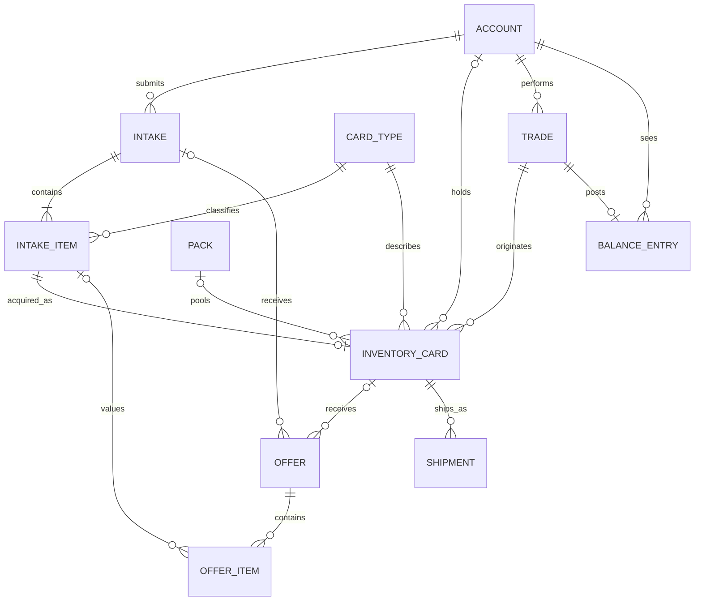

# 데이터베이스 설계서

| 항목 | 내용 |
| --- | --- |
| 프로젝트 | Pokemon-Trader-Gos |
| 문서 ID | DBS-Pokemon-Trader-Gos-v0.1 |
| 작성일 | 2026-11-24 |
| 상태 | Phase 2 초안 · G2 미승인 |

## 1. 설계 범위

실물 재고, 소유권, 배송 상태, 테스트 잔액 원장이 함께 일관되게 변경되는 관계형 논리 모델이다. DB 제품과 물리 스키마는 상세 설계에서 확정한다. [SRS](../01-요구사항분석/요구사항명세서-SRS.md) · [비즈니스정책서](../00-기획/비즈니스정책서.md)

## 2. 엔터티 관계

## 3. 논리 테이블

| 엔터티 | 키와 핵심 필드 | 제약 및 용도 |
| --- | --- | --- |
| ACCOUNT | accountId, role, testBalance | 역할은 일반 사용자 또는 운영자다. 테스트 잔액은 음수가 될 수 없다. |
| CARD_TYPE | cardTypeId, name, set, cardNumber, rarity | 카드 종류와 인쇄 레어도 코드를 저장한다. 무표기와 미확인은 임의 코드로 변환하지 않는다. |
| INTAKE_POLICY | policyId, targetRarity, requiredRarity, maximumPerCompanion | 동봉 조건별 대상 레어도, 동봉 레어도와 양의 정수 N을 관리한다. 정책값과 중복 인정 방식은 DEC-001에 따른다. |
| INTAKE | intakeId, applicantId, status, inboundTrackingNumber | 접수 번호와 신청자, 입고 운송장을 연결한다. |
| INTAKE_ITEM | intakeItemId, intakeId, cardTypeId, submittedMediaIds, inspectionStatus, conditionCode, inspectionReason, verifiedMediaIds | 제출 자료와 운영자가 확인한 실물 자료를 구분한다. 검수 판정과 상태 코드, 희귀도는 서로 다른 값이다. |
| OFFER | offerId, kind, intakeId 또는 inventoryId, recipientId, amount, priceSource, exceptionReason, status | 최초 매입은 입고 묶음, 재매입은 보유 실물 한 장을 대상으로 한다. 두 대상 중 하나만 지정한다. 제안 금액은 수락 대상 스냅샷이다. |
| OFFER_ITEM | offerItemId, offerId, intakeItemId, amount, priceSource | 최초 매입 제안에 포함된 카드와 금액을 기록한다. 재매입은 한 건의 제안 금액과 산정 근거를 OFFER에 기록한다. |
| PRICE_RULE | ruleId, kind, rarity, conditionCode, amount | 최초 매입·재매입별 기준표 후보. 금액과 예외 조건은 DEC-002에 따른다. |
| INVENTORY_CARD | inventoryId, intakeItemId, cardTypeId, holderAccountId, status, listingPrice, packId, acquisitionTradeId | 재고 번호 고유, 동일 입고 항목에서 생성되는 재고 최대 한 장. 운영자 보유 시 holderAccountId는 비어 있다. 검수 기록은 입고 항목과 연결한다. |
| PACK | packId, name, packType, rarityCodes, testPrice | 혼합형 또는 단일 레어도형과 허용 코드, 상품별 테스트 코인 가격을 관리한다. 단일형에는 코드가 하나만 있다. 재고 배정과 개봉은 허용 코드만 사용한다. 소진 조건은 DEC-004에 따른다. |
| SHIPMENT | shipmentId, inventoryId, requesterId, status, trackingNumber | 실물 한 장당 활성 요청은 최대 하나다. 묶음 배송 여부와 실제 배송 정보 범위는 DEC-005에 따른다. |
| TRADE | tradeId, actorId, idempotencyKey, operation, requestFingerprint, status, targetId, resultInventoryIds, amount, resultingBalance, errorCode | actorId와 key 조합의 중복을 막는다. 처리 결과는 조회 및 재전송에 사용한다. 거래가 여러 장을 취득하면 결과 재고 번호와 각 실물의 acquisitionTradeId로 연결한다. |
| BALANCE_ENTRY | entryId, tradeId, accountId, kind, delta, balanceAfter | 거래당 잔액 행은 최대 하나다. 차감은 음수, 적립은 양수로 기록한다. |

사진은 접근 제어가 적용되는 별도 저장소의 식별자를 참조한다. 신청 사진 등 개인 자료는 소유자와 담당 운영자에게만 제공하고, 마켓 공개 화면에는 판매에 필요한 검수 사진만 제공한다. 보존 기간과 삭제·백업 방식은 운영 설계에서 정한다.

## 4. 상태 전환

| 대상 | 상태 코드 | 전환 조건 |
| --- | --- | --- |
| 입고 | SUBMITTED → INSPECTED → OFFERED → ACQUIRED | 신청 접수, 검수 완료, 매입 제안, 사용자 수락 순서다. 검수 후 동봉 조건 미달은 ON_HOLD로 기록한다. |
| 검수 항목 | PASS, DEFECT, REJECTED | 운영자가 결과와 사유를 기록한다. REJECTED는 매입 제안에 포함하거나 판매·팩에 등록할 수 없다. |
| 제안 | OFFERED → ACCEPTED 또는 SUPERSEDED | 제안의 대상·금액·수신자가 유효할 때만 수락한다. 예외 제안으로 교체된 ID는 SUPERSEDED로 기록한다. 반려·미수락 후 실물 처리 기한은 DEC-003에 따른다. |
| 실물 카드 | OPERATOR_STOCK → LISTED 또는 PACK_AVAILABLE → HELD | 매입 확정 후 운영자 재고에서 판매처를 배정한다. 성공한 구매나 개봉만 HELD로 변경한다. |
| 보관 실물 | HELD → SHIPPING_REQUESTED → SHIPPED, 또는 HELD → OPERATOR_STOCK | 배송 요청 또는 재매입이 먼저 확정되면 다른 전환을 제한한다. 재매입 후 새 판매 배정 전까지 운영자 재고 상태다. |
| 배송 요청 | REQUESTED → SHIPPED | 요청을 접수하면 REQUESTED, 운영자가 출고 정보와 운송장을 기록하면 SHIPPED다. |

실물의 상태와 소유자는 같이 갱신한다. LISTED와 PACK_AVAILABLE을 동시에 설정하지 않는다. 구매나 팩 배정 후 활성 판매가와 packId는 비우고 거래 기록에서 이력을 유지한다.

## 5. 정합성과 동시 요청

- 입고 매입 수락은 입고·제안 상태 확인, 포함 실물 등록, 거래 성공 상태 및 적립을 한 트랜잭션에서 확정한다.
- 구매·개봉은 정해진 순서로 필요한 계정과 재고를 잠근 뒤 잔액과 재고 적격 상태를 재확인한다. 성공하면 배정과 차감을 한 트랜잭션으로 확정한다. 팩은 허용 레어도 코드에 해당하는 배정 가능 후보 중 실물 한 장을 무작위로 선택하며, 후보의 상태가 달라지면 다시 확인한다.
- 배송과 재매입은 같은 실물 행의 HELD 상태와 보유 주체를 재확인한다. 한 요청이 상태를 바꾸면 다음 요청에는 이전 상태가 성립하지 않는다.
- 요청 결과 저장은 확정된 재고·원장과 같은 트랜잭션에 포함한다. 이미 처리한 키는 이전 결과를 반환하고, 동일 키에 다른 입력을 붙이면 충돌로 처리한다. 같은 제안은 키가 달라도 이미 수락한 상태라면 추가 적립할 수 없다.
- 주요 조회 키는 신청자별 입고, 보유자별 재고, 팩별 배정 가능 상태, 사용자별 거래 내역이다. 인덱스와 실행 계획은 데이터 규모가 확인되면 정한다.

## 6. 검토 항목

FR-001~FR-010, NFR-001~NFR-002의 데이터 요구를 다룬다. 검수 반려 재고 제외, 같은 종류의 카드 두 장의 고유 번호, 마지막 재고 중복 배정 차단, 배송·재매입 충돌, 중복 적립 방지가 검토 대상이다. 물리 마이그레이션과 복구 시험은 미착수다. 거래 트랜잭션의 호출 계약은 [API설계서](API설계서.md)를 참고한다.
