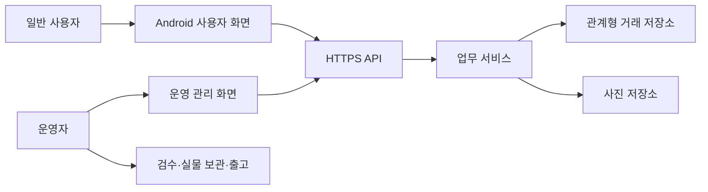

# 시스템 아키텍처 설계서 (SAD)

| 항목 | 내용 |
| --- | --- |
| 프로젝트 | Pokemon-Trader-Gos |
| 문서 ID | SAD-Pokemon-Trader-Gos-v0.1 |
| 작성일 | 2026-11-24 |
| 상태 | Phase 2 초안 · G2 미승인 |

## 1. 시스템 경계

Android 첫 버전에서 실물 카드 입고·검수·구매·팩 개봉·보관·배송·재매입을 테스트 잔액으로 검증한다. 운영자 창고에서 발생하는 검수와 출고는 운영자 화면을 통해 기록한다. 실제 결제·유료 랜덤팩·계좌 출금은 범위에서 제외한다. [SRS](../01-요구사항분석/요구사항명세서-SRS.md) · [유스케이스명세서](../01-요구사항분석/유스케이스명세서.md)

운영 화면의 구현 형태는 미결이다. 일반 사용자와 권한 있는 운영자는 같은 업무 규칙을 서버에서 적용받는다. 운송장 기록은 설계 범위에 포함하며 택배사 API 연동과 실제 물류 검증은 DEC-005에 따른다.

## 2. 구성 요소와 책임

| 구성 요소 | 책임 |
| --- | --- |
| 사용자 화면 | 도메인 상태 조회, 카드·사진 입력, 제안·가격·배송 요청 확인, 확정 요청 및 결과 표시 |
| 운영 관리 화면 | 입고·검수 조회, 판정과 사유 기록, 기준표 또는 예외 가격 확인, 재고 배정, 출고와 운송장 기록 |
| API | 세션 식별, 자원 소유권과 운영 권한 확인, 입력 검증 및 업무 오류 응답 |
| 입고·검수·가격 | 신청과 검수 시 레어도 코드별 동봉 조건 평가, 인쇄 레어도·실물 상태 기준표와 예외 제안, 수락할 제안 금액 보존 |
| 재고·거래·배송 | 실물 배정, 보유 상태 전환, 혼합형·단일 레어도형 팩의 허용 코드와 상품별 코인 가격 확인 및 후보 선택, 원장 반영, 배송 기록 |
| 관계형 저장소·사진 저장소 | 실물 ID와 거래의 원자적 기록, 사진과 접근 범위 관리 |

## 3. 설계 결정

| ID | 제안 | 근거 및 검토 |
| --- | --- | --- |
| ADR-01 | 사용자·운영자가 공통 HTTPS JSON API를 이용한다. | 가격·소유권·권한을 서버에서 판단하고 클라이언트는 상태를 표시한다. 인증 공급자와 권한 발급은 DEC-006에 따른다. |
| ADR-02 | 첫 버전의 업무 기능을 하나의 서버와 관계형 저장소로 구성한다. | 재고, 요청 결과, 테스트 잔액을 한 트랜잭션으로 확정하기 쉽다. 서버 프레임워크와 DB 제품·호스팅은 미결이다. |
| ADR-03 | 실물 번호와 서버 응답을 기준으로 거래 상태를 표시한다. | 중복 전송, 네트워크 타임아웃, 동시에 들어오는 거래에서 결과를 재조회할 수 있다. |
| ADR-04 | 화면 설계에 기존 디자인 가이드와 Android 접근성 기준을 적용한다. | 카드 사진, 검수·희귀도·배송 상태를 각각 표시하고, 확대 글꼴에서 필수 정보와 조작을 확인할 수 있다. |

## 4. 핵심 거래와 실패 경계

1. 사용자 또는 운영자가 요청하면 서버가 세션과 자원 권한을 확인한다. 계정과 가격·재고 상태는 서버 기준으로 확인한다.
2. 구매·개봉, 최초 매입 수락·재매입 수락과 배송 접수는 요청 키를 사용한다. 서버는 관련 상태와 재고를 다시 확인한 후 같은 트랜잭션에서 성공 결과를 확정한다.
3. 실패하면 해당 작업으로 인한 재고·소유권·잔액 변경을 확정하지 않는다. 응답이 끊기면 요청 키로 서버 결과를 확인하거나 같은 키로 재전송한다.
4. 검수 반려 재고는 판매와 팩 후보에서 제외한다. 구매·개봉이 경합하면 한 쪽만 확정하고, 배송과 재매입도 보관 상태를 기준으로 한 쪽만 확정한다.

## 5. 비기능 요구사항 대응

| 요구사항 | 설계 대응 | 검증 관점 |
| --- | --- | --- |
| NFR-001 | 서버의 역할 및 자원 소유권 검사, 사진 접근 제어 | 타인 거래·배송 정보 및 운영 작업 접근 제한 |
| NFR-002 | 재고 상태 전환과 원장 기록을 트랜잭션과 요청 키로 보호 | 이중 배정, 중복 잔액 변경, 배송·재매입 경쟁 확인 |
| NFR-003 | 디자인 토큰과 Android 화면의 텍스트 상태·조작 기준 적용 | 360dp와 확대 글꼴에서 필수 정보와 조작 확인 |

## 6. 상세 설계로 넘길 항목

DEC-001~DEC-006은 [서비스기획서](../00-기획/서비스기획서.md#7-다음-단계와-미결-결정)에서 추적한다. 개발 환경, 인증 공급자, 최소 Android 버전, 배포·저장소 공급자, 서비스 성능 목표 및 운영 인력은 확인 후 확정한다. G2 검토 기록은 [단계별 검토 체크리스트](../08-검토/단계별검토-체크리스트.md)에 남긴다.

- [API설계서](API설계서.md) · 요청 계약, 실패와 재시도 규칙
- [데이터베이스설계서](데이터베이스설계서.md) · 데이터 관계, 상태 전환과 거래 정합성
- [화면설계서](화면설계서.md) · 화면별 상태, 사용자 행동 및 접근성
- [RTM](../01-요구사항분석/요구사항추적매트릭스-RTM.md) · 시스템 설계 연결
