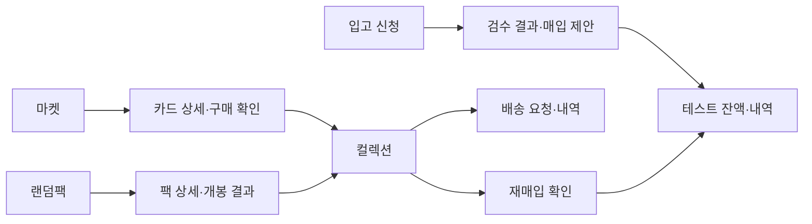

# 화면 설계서

| 항목 | 내용 |
| --- | --- |
| 프로젝트 | Pokemon-Trader-Gos |
| 문서 ID | UIX-Pokemon-Trader-Gos-v0.1 |
| 작성일 | 2026-11-24 |
| 상태 | Phase 2 초안 · G2 미승인 |

## 1. 화면 구조와 디자인

일반 사용자 Android 앱의 하단 메뉴는 **마켓 · 랜덤팩 · 입고 · 컬렉션 · 내 정보**다. 운영 기능은 권한이 있는 사용자에게 제공하는 별도 화면 영역으로 정의한다. 운영 화면의 구현 형태와 첫 버전의 로그인·계정 발급 방식은 미결이다.

[DESIGN.md](../../../DESIGN.md)의 Clay 색상, 글꼴, 버튼·배지 토큰을 사용한다. 배경은 `{colors.canvas}`, 확정 버튼은 `{colors.primary}`, 희귀도 표시는 `{components.badge-rarity}`를 적용한다. 카드 미디어 영역은 약 5:7 비율로 전체 실물을 보여준다. 희귀도·실물 검수 판정·배송 상태는 별도 텍스트 라벨로 구분한다.

## 2. 화면 목록과 상세

| ID | 화면 | 주요 정보와 행동 | 연결 |
| --- | --- | --- | --- |
| UI-01 | 마켓 | 검색창, 희귀도·검수 상태 필터, 실물 카드 그리드. 빈 결과에서는 검색어나 필터를 수정할 수 있다. | UC-004 · FR-004 · API-04 |
| UI-02 | 카드 상세·구매 확인 | 앞뒷면과 하자 사진, 카드 번호와 재고 번호, 검수 판정과 사유, 판매가를 표시한다. 구매 전 차감액과 구매 후 테스트 잔액을 확인한다. 완료 후 컬렉션으로 이동한다. | UC-004 · FR-004 · FR-005 · API-04~05 |
| UI-03 | 랜덤팩 목록·상세·결과 | 혼합형·단일 레어도형과 포함 코드, 팩별 테스트 코인 가격, 배정 장수를 개봉 전에 표시한다. 결과에는 배정된 실물과 인쇄 레어도 코드를 표시한다. 개봉 연출은 건너뛸 수 있다. | UC-005 · FR-006 · API-06 |
| UI-04 | 입고 신청 | 동봉 조건 확인 → 카드·사진 입력 → 신청 확인 순서다. 대상·동봉 레어도 코드와 필요·제출 수량을 보여준다. 확인이 필요한 레어도는 별도 안내한다. | UC-001 · FR-001 · API-01~03 |
| UI-05 | 입고 내역·검수 결과 | 신청 번호·진행 상태·택배 안내·운송장, 카드별 검수 결과·사유를 보여준다. 매입 제안에서는 금액을 확인하되 묶음이 보류되면 조건 미달 사유를 표시한다. 하자·반려 처리에 해당하는 택배비 안내를 제공한다. | UC-001~003 · FR-001~003 · API-02~03 · API-09 |
| UI-06 | 컬렉션·카드 상세 | 보유 카드 사진과 재고 번호, 검수 상태, 보관·배송 상태를 표시한다. 보관 중인 카드에는 배송 신청과 매입가 확인을 제공한다. | UC-006~007 · FR-007~008 · API-07~09 |
| UI-07 | 배송 요청·내역 | 어떤 카드를 신청하는지 확인하고 배송 요청을 접수한다. 상태와 운송장은 요청 상세에 보인다. 실제 배송지 입력·배송비는 DEC-005에서 확정한다. | UC-006 · FR-007 · API-08 |
| UI-08 | 재매입 확인 | 실물 카드와 제안 금액, 적립될 테스트 잔액을 확인하고 수락한다. 배송 요청 상태라면 재매입 제한 이유가 보인다. 성공 후 컬렉션 및 잔액 내역을 갱신한다. | UC-007 · FR-008 · API-07 · API-09 |
| UI-09 | 내 정보·테스트 잔액 | 테스트 잔액과 거래 내역을 조회한다. 개별 구매·팩 개봉 차감, 입고 매입·재매입 적립을 구분하며 거래 상태를 다시 확인할 수 있다. | UC-008 · FR-009 · API-10 |
| UI-10 | 운영자 입고·검수 | 신청 목록과 카드별 사진·희귀도를 확인하고 판정·사유·실물 상태와 제안을 기록한다. 조건 미달 시 보류 사유를 확인할 수 있다. | UC-002 · FR-002~003 · FR-010 · API-11 · API-14 |
| UI-11 | 운영자 재고·출고 | 재고 번호로 상태를 조회하고 개별 판매 또는 팩을 지정한다. 배송 요청 목록에서 출고를 처리하고 운송장을 입력한다. 재매입 예외 제안은 대상 실물을 확인한 뒤 기록한다. | UC-007 · UC-009 · FR-008 · FR-010 · API-12~14 |

## 3. 주요 이동

## 4. 상태별 표시 및 회복

| 상황 | 표시와 행동 |
| --- | --- |
| 입고 조건 미충족 | 부족한 동봉 레어도 코드와 카드 수, 수정할 입력 위치를 제공한다. 검수 후 미달이면 이유와 해당 카드의 판정을 보여준다. |
| 이미지 등록·조회 실패 | 사진 영역에서 상태를 설명하고 해당 위치에서 다시 시도할 수 있게 한다. |
| 구매·개봉 품절, 가격 변경, 잔액 부족 | 상태를 갱신하고 해당 사유를 설명한다. 새 금액을 다시 확인해야 하는 경우 바로 확정하지 않는다. |
| 거래 처리 중 또는 응답 없음 | 확정 버튼의 중복 입력을 제한한다. 응답이 불명확하면 처리 결과를 내역에서 확인할 수 있게 한다. |
| 배송·재매입 경합 | 확정된 작업의 상태와 제한 사유를 표시한다. |
| 권한 없는 조회 또는 처리 | 다른 사용자의 정보와 운영 액션을 노출하지 않고 권한 상태를 안내한다. |

## 5. 검토 기준

NFR-003에 따라 360dp 폭과 확대 글꼴에서 가격·재고 번호·상태와 오류 메시지를 읽을 수 있어야 한다. 주요 메뉴와 버튼은 44×44dp 이상의 터치 영역과 의미를 설명하는 접근성 이름을 갖는다. 색 외에 텍스트로 상태를 표시한다. 하단 메뉴와 거래 확정 영역이 안내를 가리지 않게 한다.

입고 수량 미달, 빈 검색 결과, 검수 반려, 구매·개봉 실패, 배송 요청 이후 재매입 제한과 중복 입력 방지를 화면 검증 대상으로 삼는다. Android 기기 대상과 실제 화면 검토는 미결이며 실행 결과는 기록하지 않았다. [SRS](../01-요구사항분석/요구사항명세서-SRS.md) · [유스케이스명세서](../01-요구사항분석/유스케이스명세서.md) · [API설계서](API설계서.md)
