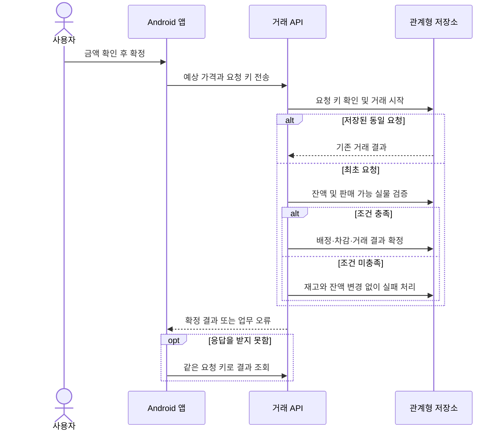

# 상세설계서

| 항목 | 내용 |
| --- | --- |
| 프로젝트 | Pokemon-Trader-Gos |
| 문서 ID | DDS-Pokemon-Trader-Gos-v0.1 |
| 작성일 | 2026-11-24 |
| 상태 | Phase 3 초안 · G3 미승인 |
| 변경 이력 | v0.1 · Phase 2 설계 기준 최초 작성 |
| 승인자·승인일 | 미결 |

## 1. 목적과 범위

Android 첫 버전의 입고, 거래, 컬렉션과 운영 관리 기능을 구현 단위별로 설계한다. 거래는 테스트 잔액으로 처리한다. 개발 언어·프레임워크, 저장소 제품과 실제 배송 범위는 후속 검토에서 정한다.

- [비즈니스정책서](../00-기획/비즈니스정책서.md) · 동봉, 검수, 가격, 재고, 잔액 정책
- [SRS](../01-요구사항분석/요구사항명세서-SRS.md) · 기능·비기능 요구사항과 수용 기준
- [시스템아키텍처설계서](../02-시스템설계/시스템아키텍처설계서-SAD.md), [API설계서](../02-시스템설계/API설계서.md), [데이터베이스설계서](../02-시스템설계/데이터베이스설계서.md), [화면설계서](../02-시스템설계/화면설계서.md) · 시스템 경계와 상세 설계의 입력

## 2. 모듈과 책임

| 모듈 | 책임과 입출력 | 요구사항 |
| --- | --- | --- |
| 요청 권한·사진 | 계정과 역할, 요청 대상의 소유권을 확인한다. 사진 등록 결과는 이후 신청이나 검수에서 검증할 수 있는 사진 ID다. | FR-001, FR-002, NFR-001 |
| 입고·검수 | 신청 정보를 검증하고 조건에 맞으면 신청 번호를 발급한다. 운영자 판정 후 조건을 재계산하고 보류 또는 제안 대상으로 분기한다. | FR-001, FR-002, FR-010 |
| 매입 제안·가격 | 최초 매입과 재매입에 기준표 및 운영자 예외를 적용하고, 사용자에게 제안 ID와 고정 금액을 반환한다. | FR-003, FR-008 |
| 판매·팩 재고 | 판매·개봉 가능 재고 조회와 배정, 상품 설명과 가격을 제공한다. 검수 반려와 이미 보유된 실물은 구매 후보에서 제외한다. | FR-004, FR-005, FR-006, FR-010 |
| 컬렉션·출고 | 보유 카드와 가능한 다음 행동을 조회한다. 배송 접수와 운영자 출고 기록을 관리한다. | FR-007, FR-008, FR-010 |
| 거래·테스트 잔액 | 요청 재시도, 거래 상태 및 잔액 원장을 관리한다. 성공한 거래의 소유권·잔액 변경을 함께 확정한다. | FR-003, FR-005, FR-006, FR-008, FR-009, NFR-002 |
| Android 화면 | Phase 2 화면과 API를 연결한다. 로딩·성공·업무 오류·결과 미확인 상태를 표시한다. | FR-001~FR-010, NFR-003 |

## 3. 공통 요청 처리

1. 요청 주체를 확인한 뒤 사용자 자원은 소유권을, 운영자 작업은 해당 권한을 검사한다. 사진 연결 시 요청 주체에게 설정된 접근 범위와 사진 용도를 확인한다. 타인 자원은 존재 여부가 드러나지 않는 응답으로 처리한다.
2. 입고 생성·개별 구매·팩 개봉·제안 수락·배송 접수는 `Idempotency-Key`를 사용한다. 계정과 키의 조합으로 기존 요청을 찾고, 메서드·대상·의미 있는 입력을 비교한다. 일치하면 기존 결과를 반환하고, 다르면 `IDEMPOTENCY_CONFLICT`로 처리한다.
3. 처음 온 키는 DB의 고유 제약으로 한 실행만 획득한다. 같은 키가 동시에 들어오면 앞선 요청의 처리 결과를 재조회한다. 키 확인만으로 업무 성공을 판단하지 않는다. 관련 레코드를 잠근 뒤 상태와 가격, 잔액·권한을 다시 확인한다.
4. 잠금 순서의 설계안은 요청 키 → 필요한 계정 → 입고·팩 → 실물 → 제안·배송 순이다. 같은 종류를 여러 건 잠글 때는 ID 순을 사용한다. 선행 조회로 찾은 대상 관계는 잠금 후 재확인한다. 운영자가 실물을 팩에 배정할 때도 관련 팩과 실물의 잠금 순서를 지킨다. DB 제품 선정 후 잠금과 충돌 재시도 방식을 검증한다.
5. 성공 결과를 업무 상태와 같은 트랜잭션에 남긴다. 판정이 끝난 업무 거절은 재고와 원장을 변경하지 않고 요청 결과로 기록할 수 있다. 저장소 오류로 롤백된 경우에는 확정된 결과가 없으므로 같은 키로 재시도할 수 있다. 이미 확정된 제안은 다른 키로 다시 보내도 중복 수락하지 않는다.

### 구매·개봉 시퀀스

## 4. 기능별 상세 흐름

### DDS-01 입고 신청과 조회

**연결** · FR-001, UC-001, API-01~03, UI-04~05

1. 사진 등록 후 카드별 이름, 세트, 카드 번호, 희귀도와 앞뒷면 사진 ID를 입력한다. 클라이언트에서 필요한 동봉 레어도와 수량을 보여주고 서버에서 다시 계산한다.
2. 서버는 적용 중인 규칙에서 대상·동봉 레어도와 N을 확인하고, 대상 코드의 카드 수를 N으로 나눈 올림값을 구한다. 조건 미달이면 필요한 코드와 제출·필요 수량을 반환하며 신청 번호를 생성하지 않는다.
3. 유효하면 신청과 카드 항목을 같이 저장하고 `SUBMITTED` 상태와 신청 번호를 반환한다. 운송장은 소유한 신청에만 연결한다. 신청 확인과 검수에 쓰는 증빙 사진은 변경 이력에서 구분한다.
4. 대상·동봉 레어도 코드, 실제 N, 카드 중복 인정 및 매입 여부는 DEC-001로 관리한다. 정책이 준비되지 않은 환경에서는 임의의 운영값으로 접수하지 않고, 테스트 전용 데이터에서만 예시값을 사용한다.

#### 레어도 코드 처리

한국판 로켓단의 뮤츠 ex `sv10 130/098 UR`처럼 세트, 카드 번호와 인쇄 레어도를 따로 기록한다. 입력한 코드가 실물과 일치하는지 운영자가 확인한다. [포켓몬코리아 카드 정보](https://pokemoncard.co.kr/cards/detail/BS2025006130)

`C`, `U`, `R`, `RR`, `AR`, `SR`, `SAR`, `UR`처럼 인쇄 코드를 동봉 수량·팩 구성·검색에 직접 사용한다. 카드 번호나 일러스트만으로 레어도를 추정하지 않는다. 무표기·미확인 카드는 운영자 확인 전 동봉 장수나 팩 후보에 자동 반영하지 않는다. [레어도 확인 기준](../00-기획/비즈니스정책서.md#인쇄-레어도-분류)

### DDS-02 검수와 최초 매입

**연결** · FR-002, FR-003, UC-002~003, API-09·11·14, UI-05·10

1. 운영자는 신청에 포함된 실물을 대조해 카드별 정품 여부, 검수 판정, 상태 코드, 사유와 사진을 기록한다. 반려 카드는 제안·판매·팩에 배정할 수 없다.
2. 검수 결과를 기준으로 동봉 조건을 재검증한다. 조건이 미달하면 입고를 `ON_HOLD`로 기록하고 사유를 표시한다. 하자 카드의 인정 기준과 처리 범위는 정책 결정에 따른다.
3. 조건을 충족한 경우 매입 대상별 기준표 가격과 예외 적용 금액을 계산하고 제안에 고정한다. 운영자가 가격을 바꾸면 새 제안 ID를 발행하고 이전 제안을 `SUPERSEDED`로 바꾼다.
4. 정해진 수신자가 현재 유효한 제안을 수락하면 대상 카드의 재고 번호를 생성한다. 제안 수락, 입고 상태, 실물 재고, 최초 매입 적립과 거래 결과가 한 번에 확정된다. 기존 재고와 제안 상태를 확인해 중복 등록을 방지한다.
5. 보류·반려·미수락 실물 처리, 하자 카드의 판매 범위와 택배비 적용 구간은 DEC-001~003에 따른다.

### DDS-03 매물 조회와 개별 구매

**연결** · FR-004, FR-005, UC-004, API-04~05, UI-01~02

- 매물 목록은 판매 가능한 `LISTED`만 반환한다. 이름·세트·카드 번호 검색과 희귀도·검수 상태 필터를 적용한다. 상세에는 공개용 검수 사진, 가격과 개별 재고 번호를 반환한다.
- 구매 확정 시 잠금 후 `LISTED` 여부, 예상 가격과 최신 가격의 일치 및 테스트 잔액을 확인한다. 성공하면 보유 계정을 바꾸고 `HELD`로 전환한다. 활성 판매가와 팩 배정은 해제하고 차감과 거래 결과를 함께 기록한다.
- 새 가격과 예상 가격이 다르거나 품절·잔액 부족이면 구매를 확정하지 않는다. 화면은 최신 정보와 실패 이유를 보여주며, 새 가격으로 진행하려면 사용자가 다시 확인한다.

### DDS-04 랜덤팩 개봉

**연결** · FR-006, UC-005, API-06, UI-03

- 팩 상세에서 테스트 코인 가격, 혼합형·단일 레어도형 구분, 포함 코드와 실물 한 장 배정을 안내한다. 팩마다 가격을 정한다. 혼합형은 표시한 여러 레어도를 포함하며, 단일형은 표시한 한 코드만 배정한다.
- 개봉 시 팩, 예상 가격과 잔액을 검증한 뒤 그 팩의 `PACK_AVAILABLE` 재고 중 허용 레어도 코드가 일치하는 실물 한 장을 무작위 선택한다. 선택한 행의 상태와 팩 ID를 잠금 후 재확인한다. 경합으로 후보를 잃으면 배정 가능한 후보를 다시 확인하고 후보가 없으면 품절로 처리하고 다른 코드로 대체하지 않는다.
- 성공 시 실물에 구매자를 연결하고 `HELD`로 전환하며, 차감과 개봉 결과를 같이 기록한다. 개봉 연출은 서버 결과 표시 단계에서만 실행하고, 건너뛰어도 같은 재고를 표시한다. 일부 레어도 소진 시 개봉 허용 조건은 DEC-004를 따른다.

### DDS-05 컬렉션·배송·재매입

**연결** · FR-007, FR-008, UC-006~007, API-07~09·13~14, UI-06~08·11

- 컬렉션에는 자신이 보유한 실물과 보관·배송 상태를 조회한다. 앱은 서버가 반환한 가능한 행동을 반영한다.
- 배송 요청은 해당 재고의 소유자와 `HELD`를 확인한 뒤 `SHIPPING_REQUESTED` 전환 및 `REQUESTED` 요청 생성을 함께 확정한다. 운영자가 기록한 운송장과 출고를 사용자에게 보여준다.
- 재매입가는 기준표 또는 예외 제안으로 조회한다. 조회하거나 제안을 받는 것만으로 실물을 예약하지 않는다. 수락 시 소유자·`HELD`·유효 제안을 잠금 후 다시 확인하고, 운영자 보유와 테스트 잔액 적립을 함께 확정한다.
- 배송과 재매입이 동시에 요청되면 하나만 `HELD`에서 전환할 수 있다. 뒤따른 요청에는 현재 상태와 제한 사유를 표시한다. 배송지 입력, 배송비와 묶음 배송은 DEC-005를 따른다.

### DDS-06 잔액과 결과 복구

**연결** · FR-009, UC-008, API-10, UI-09

- 테스트 잔액 원장에는 개별 구매·팩 개봉 차감과 입고 매입·재매입 적립을 구분해 거래당 최대 한 줄로 기록한다. 잔액과 원장 결과는 같은 트랜잭션에서 저장한다.
- 결과를 모를 때는 요청 키로 거래 결과를 조회하거나 같은 키로 재전송한다. 앱은 확인되지 않은 거래를 성공으로 표시하지 않는다. 복구할 수 있도록 확인 작업의 요청 키를 결과 확인까지 유지한다.
- 재전송 응답은 당시 확정 잔액을 포함할 수 있으므로 최신 잔액은 다시 조회한다. 로그에는 거래 번호와 오류 코드 중심으로 남기고 사진·주소·인증 정보는 남기지 않는다.

### DDS-07 운영자 재고와 출고

**연결** · FR-010, UC-002·009, API-11~14, UI-10~11

- 운영 권한이 있는 요청만 기록을 변경한다. 매입이 확정되고 판매 가능한 실물만 개별 판매가 또는 팩으로 배정한다. 판매와 팩의 활성 배정은 동시에 두지 않는다.
- 재고 번호로 검수 기록과 현 상태를 조회한다. 출고 확정 시 배송 요청 상태, 운송장과 실물 `SHIPPED`를 함께 반영한다. 이미 출고된 요청의 내용을 바꾸는 정책은 확인이 필요하다.

## 5. 상태 전환 요약

| 대상 | 정상 전환 | 예외 |
| --- | --- | --- |
| 입고 | SUBMITTED → INSPECTED → OFFERED → ACQUIRED | 검수 후 조건 미달은 ON_HOLD |
| 실물 검수 | 검수 후 PASS, DEFECT, REJECTED 중 판정 기록 | REJECTED는 배정 대상 제외 |
| 매입 제안 | OFFERED → ACCEPTED | 교체 제안은 이전 제안을 SUPERSEDED로 기록 |
| 실물 재고 | OPERATOR_STOCK → LISTED 또는 PACK_AVAILABLE → HELD | 판매와 팩의 활성 배정은 상호 배타 |
| 사용자 보관 | HELD → SHIPPING_REQUESTED → SHIPPED 또는 HELD → OPERATOR_STOCK | 배송과 재매입은 동시에 확정되지 않음 |
| 배송 요청 | REQUESTED → SHIPPED | 운송장과 출고 상태 기록은 권한 있는 운영자가 처리 |

## 6. 코드 구조와 화면 상태

- 화면은 표시·입력 검증·이동을 담당하고 서버는 권한·금액·재고·원장 확정을 담당한다. 트랜잭션 경계는 화면 요청이 아닌 서버의 업무 단위에 둔다.
- API 필드와 오류 코드는 Phase 2 계약을 사용한다. 입력 오류는 해당 필드, 재고·제안 충돌은 최신 상태, 응답 없음은 거래 결과 확인으로 연결한다.
- Android 화면에서는 희귀도·검수·배송 상태를 텍스트로 구분한다. 360dp 폭과 확대 글꼴에서 카드명·금액·오류 문구가 읽히고 핵심 터치 영역이 44×44dp 이상인지 확인한다. NFR-003의 검증 기기와 Android 버전 범위는 미결이다.

## 7. 검증 및 G3 인계

| 연결 | 확인할 조건 |
| --- | --- |
| TC-FN-001~003 | 코드별 N과 N+1 경계, 검수 후 보류와 반려 제외, 변경된 제안 수락 제한, 최초 매입 적립·재고 등록 한 번 |
| TC-FN-004~006 | 검색·상세 정보, 마지막 판매 재고, 부족 잔액, 혼합형·단일형의 허용 코드와 팩별 코인 차감, 팩 소진, 결과와 컬렉션 번호 일치 |
| TC-FN-007~010 | 보관 카드 배송과 운송장 조회, 재매입 후 소유권 이동, 응답 누락 복구, 운영자 재고·출고 관리 |
| TC-NF-001~003 | 타인 정보·운영 기능 제한, 동시 처리 및 재시도 정합성, Android 접근성 |

이 항목은 [RTM](../01-요구사항분석/요구사항추적매트릭스-RTM.md)에 연결하는 검증 예정 범위다. 구현과 실행 결과는 미연결 상태다.

| 미결 항목 | 확인 기준 | 담당자·기한 |
| --- | --- | --- |
| DEC-001~003 | 동봉 대상·필요 레어도 코드와 장수, 매입 가격표와 예외·하자·반송 정책 | 미지정 · 미정 |
| DEC-004~006 | 팩별 코인 가격·레어도 구성과 판매 유지 정책, 배송 범위·운송장·계정 방식 | 미지정 · 미정 |
| 개발 환경 | Android 버전·빌드 도구, 서버·DB·사진 저장 제품, 로컬 테스트 데이터와 실행 방법 | 미지정 · 미정 |

G3 검토에서는 상세 설계 버전, 코드 작성 기준, 개발 환경 준비와 미결 결정의 영향을 [단계별 검토 체크리스트](../08-검토/단계별검토-체크리스트.md#phase-3-상세-설계-검토)에 기록한다.
